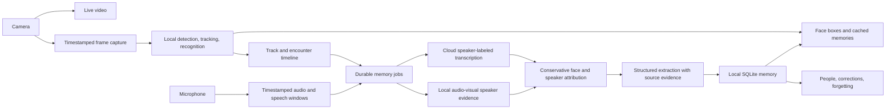

# Remind: real-time, patient-owned memory

Date: 2026-10-08. Status: approved by the user; implementation pending.

## Intent and constraints

Remind helps one patient remember people they meet. The primary screen is the
camera view, with a box and a short memory attached to each recognized face.
New people should be remembered automatically during interactions, without a
manual face-registration step. On a later encounter, show supported personal
information and the previous interaction. An optional People view supports
inspection, correction, and forgetting.

The user authorizes a complete rewrite, removal of unrelated features, and no
backward compatibility. They confirmed cloud audio processing and English-only
conversation support. Verified target hardware: Intel Core i7-1360P (12 cores,
16 logical CPUs), approximately 16 GB RAM, and NVIDIA GeForce RTX 2050 with
4 GB VRAM. `nvidia-smi` succeeds outside the sandbox with driver 615.71.09;
its initial sandbox failure was not a missing-driver diagnosis. Start with a
CPU-compatible local backend; measured hardware results determine whether an
accelerated recognizer is necessary. The baseline workload is 1–3 visible faces
and up to 500 stored people, with larger workloads measured separately.

The goal is at least 10 freshly processed video frames per second, low latency,
and reliable identity and fact attribution. Targets below are acceptance goals,
not existing performance claims. Prefer leaving information unknown to showing
the wrong person's name or memories.

## What the current workspace establishes

The checkout already has extensive uncommitted changes from an unfinished
rewrite. Preserve those changes while replacing the application deliberately;
do not reset the checkout. Existing READMEs reference an approved October 7
design and evaluation document, but those files are absent from this checkout.
Those references do not establish an available implementation specification.

| Finding | Evidence | Consequence |
| --- | --- | --- |
| No concrete face recognizer | `backend/src/providers/vision.py` contains a protocol; live route injects none | Recognition and enrollment cannot work |
| Capture interval 167 ms; server sample interval 500 ms | `frontend/src/features/live/live-session.ts:11`, `backend/src/core/config.py:24` | Nominal ceilings around 6 and 2 fps respectively |
| Only first detection is used | `backend/src/realtime/session_orchestrator.py:187` | No persistent multi-person tracking |
| Previous encounter is never resolved | `backend/src/api/routes/live.py:63` sets `recent_event=None` | Core reminder content is absent |
| Introductions directly create people | `backend/src/services/interaction_service.py:108` | No evidence-backed link between the new profile and a face |
| Cloud failures can be swallowed | `backend/src/realtime/session_orchestrator.py:329,339` | Memory can silently disappear |
| No face-attached overlays | `frontend/src/pages/LiveAssistantPage.tsx` | Main visual flow is absent |
| Incomplete replacement package | `backend/tests/test_store.py:2` | Backend test collection fails: `No module named 'remind'` |

Baseline commands on this date: `npm test -- --reporter=dot` passed 43 tests in
8 files; `uv run pytest -q` failed during collection as above. These results do
not test real recognition or a microphone/camera session.

## Technology choices

| Approach | Strengths | Limitations | Decision |
| --- | --- | --- | --- |
| Local OpenCV detection/recognition, cloud speech and extraction | Small deployment, local identity processing, no network dependency for recall | Must benchmark CPU throughput and open-set identity accuracy | Recommended baseline |
| Browser inference using an ONNX/WebGPU stack | Avoids camera-frame transport to a local server | Browser/device variability, model loading and persistence complexity | Reconsider for glasses portability after the memory loop works |
| Cloud face recognition or a continuous vision-language model | Managed inference | Network latency, recurring frame cost, remote face processing, still needs tracking and attribution | Exclude from the frame loop |

Use YuNet detection and aligned SFace embeddings through OpenCV initially.
OpenCV documents this combination, and SFace's Zoo weights use MobileFaceNet.
The supplied model directories have MIT (YuNet) and Apache-2.0 (SFace) licenses.
Pin exact weight versions and SHA-256 checksums and retain license files. The
application must not download moving model versions at startup. These are
practical baseline candidates, not a claim that they are the most accurate
available models. [OpenCV tutorial][opencv], [YuNet][yunet], [SFace][sface].

Keep an embedding-provider boundary. If SFace fails the recognition acceptance
gate, compare a licensed InsightFace/ArcFace model under the identical replay
protocol. InsightFace code and pretrained model licensing differ; the published
weights have non-commercial research restrictions unless separately licensed.
Do not make those weights an implicit deployment requirement. [InsightFace][insightface].

Keep Python/FastAPI and React/Vite. Replace PostgreSQL, pgvector, semantic
embeddings, and the general memory graph with SQLite plus a bounded in-memory
matrix of normalized face embeddings. SQLite WAL suits a local database with
concurrent readers; serialize writes and keep transactions short. No Redis,
Celery, vector server, face-service container, or separate hosted database is
needed. [SQLite WAL][sqlite].

## Runtime architecture

### Camera and fast vision path

- Request 1280×720 camera input around 30 fps; preserve native aspect ratio.
  Display it directly. Initially resize inference input to 640 pixels wide,
  retaining sufficient source quality for aligned face crops.
- Capture only fresh decoded frames using `requestVideoFrameCallback`, with a
  timed fallback where unavailable. Use asynchronous encoding and binary
  transport rather than synchronous base64 data URLs. [Browser callback][rvfc].
- Give vision a separate channel from audio and a bounded queue: at most one
  frame in inference and one newest pending frame. Replace old pending frames.
  Account for client encoding and WebSocket buffered bytes as well as server
  queue depth. Dropping old frames must never mean reporting them as processed.
- Warm model instances once. Run inference outside the ASGI event loop with
  exclusive ownership of each model instance and a bounded thread/process
  budget. Cloud jobs cannot occupy the vision executor.
- Detect and update tracks on fresh frames at the target rate. Run embeddings
  immediately on new tracks, during uncertain associations, and periodically
  on established tracks. Report embedding evaluation rate separately from
  detector/tracker fps. Recognition does not require rerunning an embedding
  for every face on every display frame.
- Associate detections one-to-one using geometry and appearance. Crossing,
  occlusion, and conflicting matches invalidate identity until re-established.
  Never carry a name forward solely because two bounding boxes overlap.
- Results include generation, sequence, capture timestamp, source dimensions,
  normalized boxes, track IDs, identity state, evidence age, and processing
  timings. Reject stale or old-generation messages on the client. Clear boxes
  after a short missing-observation timeout rather than leaving stale labels.
- Keep memory cards cached by person ID and memory version. Rendering a frame
  must not perform an LLM call or a database query per face.

### Recognition and automatic enrollment

Use distinct states: observing, unknown, ambiguous, remembered. A low-quality
face is not evidence that a person is new. Check detection confidence, crop
size, blur, exposure, and landmark geometry before identity decisions.

Match normalized embeddings against a bounded collection of diverse templates
per person. Require a calibrated top-person score, a margin over the runner-up
person, and consistent evidence across multiple observations. Similarity is not
a calibrated probability. OpenCV's published example threshold is a starting
reference, not the operating threshold for Remind. [OpenCV tutorial][opencv].

Create a provisional person only after a stable, good-quality unknown face has
participated in a sustained encounter. Start with a 2-second dwell and at least
5 usable observations as tunable defaults. Immediately recheck the gallery
inside serialized enrollment before committing, so concurrent tracks cannot
create the same identity independently. Ambiguous matches remain unassigned.
Background passers-by do not automatically become contacts merely because a
detector sees them. An encounter can also be recorded as a sustained silent
meeting, without inventing conversation content.

The provisional person gets an internal ID and an honest label such as "Person
you met today." Store a small, diverse set of high-quality templates and one
thumbnail. A name is optional: the person can be recognized again before their
name has been learned. Add new templates only after stronger sustained evidence
than a one-frame match, to reduce contamination. Manual corrections override
automatic extraction. Different people with the same name remain distinct.

### Audio, speaker attribution, and facts

Capture audio using AudioWorklet with explicit sample-rate conversion, a
monotonic timeline, sequence numbers, and discontinuity markers. Use local VAD,
pre-roll, and short bounded speech windows; flush the final partial window on
Stop. An initial maximum window of 8 seconds bounds pending memory delay.
[AudioWorklet][worklet].

Use the existing OpenAI account for `gpt-4o-transcribe-diarize` with
`diarized_json`. It supplies speaker-labeled, timed segments. Speaker labels
are scoped to an audio request, not permanent person identifiers. A patient's
optional short voice reference can help distinguish their speech, but is not
proof that every other voice belongs to a visible visitor. [Transcription API][stt].

**Diarization alone does not identify a face.** Evaluate Light-ASD as a local
audio-visual evidence provider using synchronized face clips and audio. Its
published implementation operates on 25 fps video and 16 kHz audio; preserve a
separate short media buffer for this path instead of feeding it the lossy 10 fps
recognition queue or pretending duplicated frames are equivalent. Run it outside
the frame loop. A browser clip buffer can upload bounded speech-window media
on the memory channel; worker decoding retains capture timestamps and explicit
gaps. Only retain clips until processing/expiry. The published batch pipeline
needs a bounded-window adapter and target-hardware validation; it is not a
drop-in streaming solution. [Light-ASD repository][asd], [reference pipeline][asdcode].

Accept a speaker-to-person link only when timestamp overlap and audio-visual
evidence agree uniquely across the utterance. Require continuous track evidence;
mark overlaps, off-screen speech, missing media, and conflicting candidates as
unresolved. A single visible face, lip motion alone, or an LLM guess is
insufficient. Without a validated attribution provider, preserve encounter
transcripts and summaries but leave personal statements unassigned. That mode
is useful degradation, not completion of automatic personal-fact learning.

Extract typed facts and a short encounter summary using schema-constrained
output. Each fact includes subject, predicate, value, supporting transcript
segment IDs, exact evidence text, and attribution status. Validate that evidence
exists and the subject mapping is allowed before saving it; valid JSON alone
does not prove factual truth. The model proposes facts and never chooses face
identities or writes the database directly. [Structured outputs][structured].

Only store age, name, relationship, and other personal details when stated or
corrected. Do not estimate age or relationship from appearance. Store an age
statement with its date rather than treating it as a timeless value. Track
conflicting claims; do not silently replace an existing name or relationship.
Statements about absent third parties stay distinct from facts about the
speaker. Preserve uncertainty and negation in summaries.

### Encounters and persistence

An encounter contains participant-presence intervals, not a permanent "primary"
face. Entry, sustained absence, and interaction timeouts control participant
intervals. After all participants leave for a configurable grace period, close
the encounter. A new participant in an ongoing group gets their own interval.

Keep a single database-enforced patient record; people, face templates,
encounters, participant intervals, transcript segments, attributed facts, and
memory jobs are the essential records. Store timestamps in UTC and media offsets
on their session timeline. Index person/time lookups. No patient selector or
caregiver approval role is needed.

Snapshot job inputs with immutable encounter and participant IDs, media offsets,
and relevant versions. Use unique job keys, short write transactions, retry
leases, bounded retries, and idempotent commits. Restart recovers pending jobs.
Jobs completing out of order must not overwrite newer or corrected information.
Closing a socket does not discard a persisted memory job. A new live session
cannot inherit a previous session's active tracks or pending UI messages.

"Last interaction" is the most recent completed encounter involving this person
before their current encounter. Exclude the current encounter explicitly. If
summarization is still pending, show the previous encounter's date and processing
state rather than substituting the current conversation or fabricating content.

### User interface and ownership

The camera fills the main screen with small readable cards beside face boxes:
name or provisional label; supported relationship/age; last interaction and
date. Show only a few lines. Keep text off the face, handle screen edges and
multiple cards, and map coordinates correctly through resizing and mirroring.
Remove the current decorative darkening and unrelated status copy.

Start/Stop controls own camera and microphone access. Stopping releases devices,
flushes buffered audio, and shows whether memory jobs are still saving. A compact
status reports unavailable recognition or paused memory capture. Detailed fps,
latency, and queue diagnostics belong in an expandable panel.

People provides thumbnails, facts with their sources, encounter history,
correction, and forgetting. Forget removes templates, personal facts, relevant
media and cached cards, and invalidates pending jobs that could recreate them.
Shared encounter text must be removed or redacted consistently, rather than
leaving the deleted person's facts behind. A later deliberate encounter may
create a new provisional identity; forgetting cannot retain hidden face data
solely to prevent re-enrollment.

Keep the backend bound to localhost, validate browser origins on HTTP and
WebSockets, and keep provider keys server-side. Cloud-approved audio/text may
leave the device; the identity gallery remains local. Local memory, model files,
temporary media, and credentials are excluded from source control. Set bounded
media retention and disk limits; surface capture pauses instead of silently
dropping audio when storage is exhausted.

## Removal scope

Remove standalone relationship/event/media CRUD, semantic search and embeddings,
the graph service, caregiver-review policy, patient selection/profile workflow,
the obsolete live protocol, and unused frontend components/dependencies. Retain
only media handling needed for enrollment, speech attribution, and evidence.
Replace the database baseline and stale API documentation with the new contract.
Remove obsolete tests as their implementations disappear; replace them with
behavior tests for the new memory loop rather than keeping compatibility shims.

## Acceptance and implementation boundaries

The full acceptance protocol is in [the evaluation strategy](../../testing/realtime-memory-evaluation.md).
The first integrated milestone must demonstrate: stranger enters; face enrolls;
speaker-attributed introduction and fact are saved; person leaves; process
restarts; person returns; correct face-attached previous memory appears.

Subsequent acceptance includes multiple faces, crossings, noise, ambiguous
identity, provider failure, disconnects, corrections, and deletion. Automatic
attribution and measured performance are release gates, not tasks to silently
defer while calling the rewrite complete.

Required setup: local model files and dependencies, microphone/camera permission,
and an OpenAI API key with transcription and structured-extraction access. No
additional hosted service is proposed. The text extraction model remains
configuration-driven and must be evaluated on the supplied English scenarios.
Real encounter recordings and measured runs on the verified hardware are
required to substantiate the 10 fps and accuracy claims. Code tests alone
cannot do that.

## Research sources

[opencv]: https://docs.opencv.org/4.13.0/d0/dd4/tutorial_dnn_face.html
[yunet]: https://github.com/opencv/opencv_zoo/tree/main/models/face_detection_yunet
[sface]: https://github.com/opencv/opencv_zoo/tree/main/models/face_recognition_sface
[insightface]: https://github.com/deepinsight/insightface#license
[sqlite]: https://sqlite.org/wal.html
[rvfc]: https://developer.mozilla.org/en-US/docs/Web/API/HTMLVideoElement/requestVideoFrameCallback
[worklet]: https://developer.mozilla.org/en-US/docs/Web/API/AudioWorklet
[stt]: https://developers.openai.com/api/reference/resources/audio/subresources/transcriptions/methods/create
[structured]: https://developers.openai.com/api/docs/guides/structured-outputs
[asd]: https://github.com/Junhua-Liao/Light-ASD
[asdcode]: https://github.com/Junhua-Liao/Light-ASD/blob/main/Columbia_test.py
